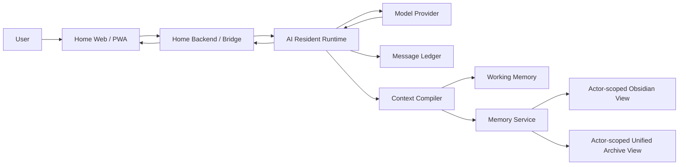

# Home — Persistent Multi-Agent AI Workspace

> A persistent AI workspace for identity, memory, permissions, runtime orchestration and reliable AI interactions.

**Status:** Active development · Production-backed prototype  
**Focus:** Applied AI systems · LLM integration · memory architecture · runtime reliability · product delivery

---

## Why I Built This

Most AI chat experiences are optimized around individual conversations.

I wanted to explore a different problem:

**What would it take to build an AI workspace where identity, memory, permissions and conversation continuity survive refreshes, new sessions, model changes and multiple entry points?**

Home started as a personal experiment and evolved into a production-backed applied AI systems project covering:

- stable AI resident identity
- durable message history
- independent AI runtimes
- bounded context and working memory
- provenance-aware retrieval
- actor-scoped permissions
- event-driven integrations
- testing, migration and rollback

This repository is a **sanitized public case study**. Production code, private conversations, secrets, personal memory and internal configuration are intentionally excluded.

---

## Product Experience

Home is designed as a long-running workspace rather than a conventional chat-only interface.

### Spatial workspace

The Rooms surface turns system concepts into user-facing spaces such as a private wing, living room, reading room, workroom and memory hall. The goal is to make different interaction modes understandable without exposing backend implementation detail.

### Integration surface

The Connections surface communicates planned and available system capabilities. Unwired integrations are explicitly marked **MOCK · NOT CONNECTED** rather than presented as live production features.

A private Chat screenshot is intentionally excluded from this public repository because it contains personal conversation context. A sanitized demo conversation can be added later.

---

## What I Built

Home separates the user-facing workspace from the AI runtime, durable state and retrieval layers.

The key design principle is:

> **Stable identity, variable context.**

A resident can move across sessions, models or channels without treating each runtime instance as a new identity.

---

## Current Architecture

### 1. Home Interface
A React / TypeScript / Vite-based interface for long-running AI conversations and workspace interactions.

The UI is treated as a **projection**, not the source of truth.

### 2. Home Backend / Bridge
Controls the boundary between the browser and AI runtimes.

Responsibilities include:

- request validation
- server-side secret protection
- streaming response delivery
- stable message identity
- correlation and failure handling

### 3. Resident Runtime
Owns execution logic rather than delegating orchestration directly to the browser or model provider.

Responsibilities include:

- fixed logical actor identity
- provider/model routing
- timeout and retry boundaries
- message lifecycle
- idempotency
- context assembly
- tool and capability access

### 4. Message Ledger
Durable conversation state for Home.

The Ledger is the message source of truth; the UI and model are consumers of that state.

### 5. Context & Memory
Home separates **durable history** from **per-turn model context**.

The current design combines:

- Identity Core
- Working Memory
- Recent Raw Tail
- Derived Context Artifacts / Chunk Summaries
- Memory Service retrieval
- bounded Context Packs

Older conversation history is retained rather than repeatedly loaded into every model call.

### 6. Unified Archive
A source-neutral evidence layer that preserves raw records while exposing controlled, actor-scoped retrieval views.

Derived summaries and indexes remain rebuildable; source evidence remains canonical.

---

## Key Engineering Decisions

### Durable history ≠ current context
A long-running conversation can be effectively unbounded at the application layer while each model turn still receives a bounded context.

### Runtime identity ≠ model identity
The model/provider is an execution engine, not the resident identity.

### Authorization before retrieval
Semantic similarity is never treated as permission. Actor scope and access rules are applied before memory retrieval.

### Derived artifacts are rebuildable
Summaries and working-memory artifacts never overwrite raw source evidence.

### UI state ≠ durable state
Refreshable interface state is kept separate from facts that must survive reconnects and new sessions.

### Reliability before automation
New memory behaviour is introduced through shadow evaluation, acceptance gates and rollback paths before it can affect production answers.

More detail: [Design Decisions](docs/DESIGN_DECISIONS.md)

---

## Reliability & Validation

The project uses production-style validation rather than treating “the app runs” as sufficient evidence.

Examples include:

- regression suites
- real Home streaming canaries
- idempotent replay tests
- permission-negative tests
- restart / reconnect recovery
- fail-closed retrieval behaviour
- controlled runtime installation
- rollback verification
- shadow-mode memory evaluation
- provider-payload neutrality checks

A recent milestone moved the Context Compiler into **production shadow observation**: the system can evaluate what context and memory it *would* use without allowing those shadow decisions to change the real model prompt or answer.

---

## Project Status

| Area | Status |
|---|---|
| Home UI / PWA | ✅ Working |
| Independent AI runtime | ✅ Working |
| Streaming model responses | ✅ Working |
| Durable Message Ledger | ✅ Working |
| Stable actor identity | ✅ Working |
| Unified Archive views | ✅ Working |
| Actor-scoped Obsidian access | ✅ Working |
| Working Memory continuity | ✅ Working |
| Context Compiler | ✅ Production shadow observation |
| Automatic memory recall into answers | 🟡 Not yet enabled |
| Second resident Home-native memory | 🟡 Planned / in progress |
| Additional external channels | 🟡 Roadmap |

---

## My Role

I drive:

- problem framing
- architecture decisions
- system boundaries and constraints
- requirements and acceptance criteria
- debugging strategy
- testing and production validation
- rollout / rollback decisions
- documentation and portfolio evidence

I use AI extensively as an implementation partner for coding, review and iteration.

I do **not** present the project as if every line of implementation was written manually by me.

---

## Technologies & Concepts

**Languages / Frontend**  
Python · SQL · TypeScript · React · Vite

**Data / Integration**  
SQLite · FTS · JSON · REST APIs · SSE · MCP

**AI Systems**  
LLM APIs · context engineering · memory systems · retrieval · structured outputs · tool integration

**Engineering**  
Git · idempotency · state management · permissions / ACL · provenance · regression testing · rollback · observability

---

## Repository Guide

- [Architecture](docs/ARCHITECTURE.md)
- [Memory Architecture](docs/MEMORY.md)
- [Key Design Decisions](docs/DESIGN_DECISIONS.md)
- [Sanitized Context Pack Example](examples/context-pack.example.json)
- [Sanitized Message Envelope Example](examples/message-envelope.example.json)
- [Screenshots & Publication Rules](screenshots/README.md)

---

## What This Project Demonstrates

This project is less about building “another chatbot” and more about answering systems questions around applied AI:

- Where should identity live?
- What is the source of truth for conversation state?
- How should long-running memory be compressed without destroying evidence?
- When should an AI retrieve older memory?
- How do permissions survive semantic retrieval?
- How do you introduce new AI behaviour safely into a live system?
- How do you separate model capability from runtime control?

Those are the questions I am most interested in working on in AI Solutions, Implementation and Product Delivery roles.
