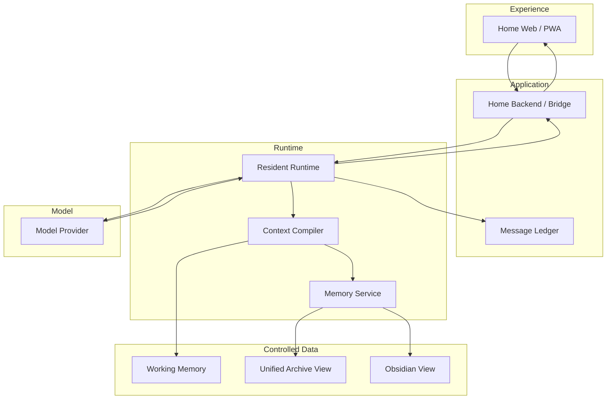

# Architecture

This document describes the public, sanitized architecture of **Home**.

## System Layers

## Responsibility Boundaries

### Home Web / PWA
Responsible for interaction and presentation.

It does **not** own canonical conversation history, model credentials or resident identity.

### Home Backend / Bridge
Acts as the browser-facing application boundary.

It validates requests, protects server-side secrets, forwards work into the appropriate runtime and streams results back to the client.

### Resident Runtime
Owns execution policy for a stable logical actor.

A runtime can select models/providers and manage tools without redefining the resident identity.

### Message Ledger
Stores durable Home message state.

Refresh, reconnect or runtime restart should not cause the UI timeline to become the canonical record.

### Context Compiler
Builds a bounded per-turn Context Pack from multiple sources.

It is designed to answer:

> What is the minimum correct, traceable context required for this turn?

### Memory Service
Provides controlled retrieval planning rather than exposing raw databases directly to the model.

Its responsibilities include:

1. trusted principal / actor scope
2. structured filters
3. candidate retrieval
4. ranking / re-ranking
5. provenance-backed memory cards
6. bounded return size

### Unified Archive
Preserves source evidence across supported channels.

Indexes and summaries may be rebuilt. Raw evidence is not silently overwritten by derived artifacts.

## Trust Boundary

The public architecture follows one important rule:

> Caller-supplied identity is not treated as trusted authorization.

Actor identity and capability boundaries are bound through controlled application/runtime configuration rather than being supplied freely by the model.

## Multi-Resident Direction

Home is designed so multiple residents can eventually share capabilities without sharing private state.

Shared engine logic can be reused, while each resident keeps isolated:

- actor identity
- private working memory
- retrieval state
- archive view
- Obsidian view
- permissions
- runtime context

**Capability parity does not imply memory parity.**
