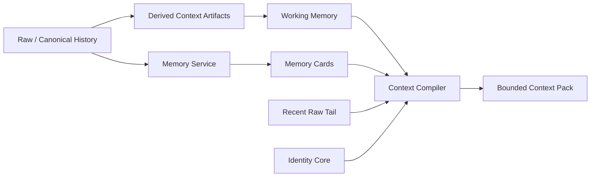

# Memory Architecture

Home treats memory as a system of layers rather than a single “memory database”.

## Core Principle

> **Stored memory is not the same thing as current model context.**

Durable storage can grow over time. A model call still needs a bounded, relevant Context Pack.

## Memory Layers

### Raw / Canonical History
Durable source evidence.

Examples include message records and imported source history.

Compression does not delete this layer.

### Derived Context Artifacts
Rebuildable summaries generated from source ranges.

Typical metadata includes:

- source references
- coverage
- compiler version
- token count
- validity
- supersession / revision state

### Working Memory
A compact continuity capsule for current state.

It can contain:

- current goals
- recent decisions
- corrections
- open loops
- next actions
- current project context

Working Memory is mutable and revisioned; it is not the immutable historical record.

### Recent Raw Tail
A bounded amount of recent dialogue retained verbatim when useful.

### Memory Service
Used when the current turn needs older or more specific information.

Retrieval is not simply “vector search”. The design includes authority and access filtering before semantic recall.

### Context Compiler
Combines the minimum sufficient material for a model turn.

Current design modes:

- **Live** — continuity without broad retrieval
- **Recall** — add a small number of relevant memory cards
- **Deep Recall** — retrieve exact evidence / provenance for high-specificity tasks

## Token Economy

The design intentionally prevents input context from growing linearly with chat length.

Illustrative soft targets currently used by the project:

- Identity Core: ~300–600 tokens
- Working Memory: ~600–1,200
- Recent Raw Tail: ~3,000–6,000
- Typical Live input: ~5,000–9,000
- Default Recall addition: 1–3 high-relevance cards, ~800–1,600 tokens

These are engineering targets, not immutable constants.

## Shadow Before Activation

Memory decisions are evaluated before they are allowed to influence production answers.

Shadow evaluation records things such as:

- proposed mode
- recall reason
- selected artifacts
- token allocation
- retrieval latency
- compiler version
- whether provider payload remained unchanged

This enables quality evaluation without silently changing model behaviour.

## Why This Matters

A useful long-running AI system needs to solve several different problems:

1. **Continuity** — what are we doing now?
2. **Recall** — what happened before?
3. **Authority** — which source should win when memories conflict?
4. **Permission** — is this resident allowed to access that memory?
5. **Budget** — how much context is useful for this turn?
6. **Evidence** — can the system trace a claim back to source material?
